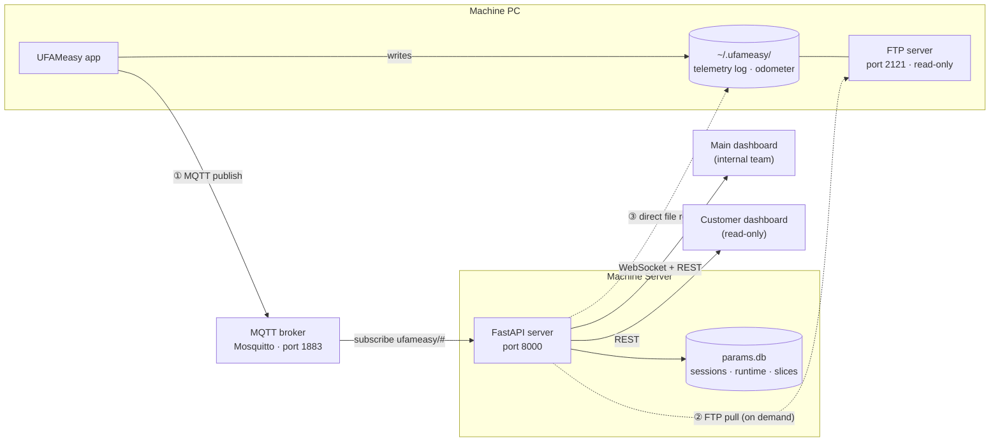
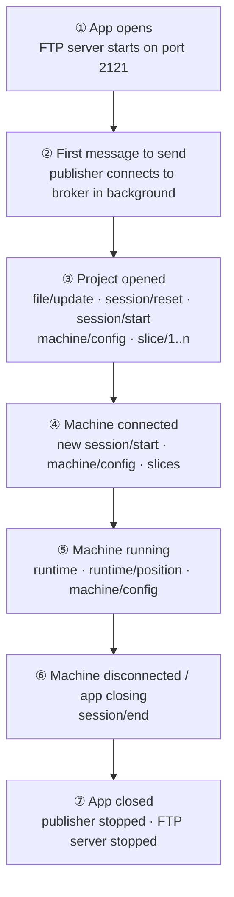
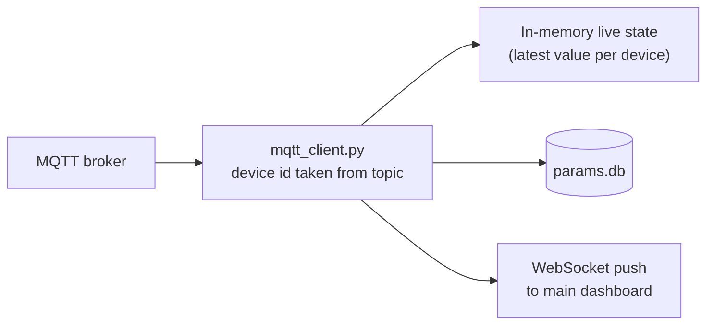
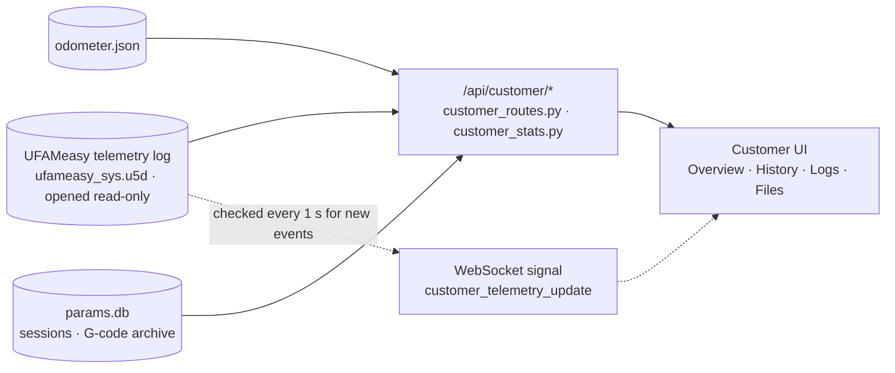
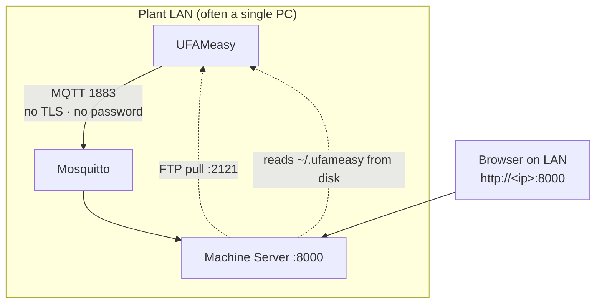
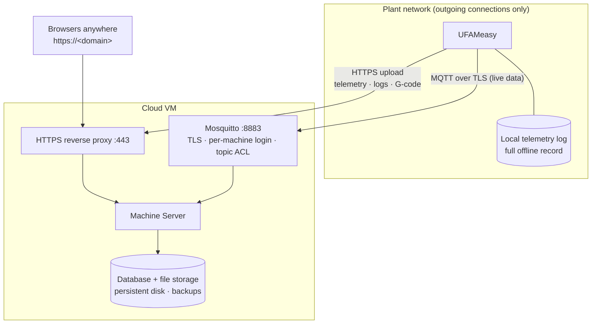

# UFAMeasy ↔ Machine Server: Data Flow Architecture

| | |
|---|---|
| **Author** | Lavanya Gawas |
| **Repositories** | `UFAMeasy` (workbench `Mod/RadialInfillWorkbench`) · `UFAMeasy_Machine_Server` |
| **Server branch** | `feature/customer-dashboard` |
| **Status** | Running on the plant LAN. Cloud hosting planned (see [Section 7](#7-cloud-hosting-plan)) |
| **Out of scope** | Live camera streaming and Remote Machine Control (RMC). Both exist in the code but are documented separately |

---

## Contents

1. [Summary](#1-summary)
2. [System overview](#2-system-overview)
3. [UFAMeasy side: open to close](#3-ufameasy-side-open-to-close)
4. [MQTT message reference](#4-mqtt-message-reference)
5. [Machine Server side](#5-machine-server-side)
6. [Customer dashboard](#6-customer-dashboard)
7. [Cloud hosting plan](#7-cloud-hosting-plan)
8. [Failure behaviour](#8-failure-behaviour)
9. [Known issues](#9-known-issues)
10. [Ports and configuration](#10-ports-and-configuration)
11. [Code map](#11-code-map)

---

## 1. Summary

- **UFAMeasy** (FreeCAD-based machine software) publishes machine data as small JSON messages over **MQTT**.
- The **Machine Server** (FastAPI) subscribes to those messages, stores them in **SQLite** (`params.db`), and pushes them live to the **main dashboard** over WebSocket.
- For logs, the server **pulls** a CSV file from UFAMeasy over **FTP** when a user asks for it.
- The new **customer dashboard** is a read-only view. It reads UFAMeasy's local telemetry log directly from disk, so today the server must run on the **same PC** as UFAMeasy.
- Running the machine never depends on the server. If the server is down, the machine keeps working and UFAMeasy keeps its own full local log.
- To host the server in the cloud, data flows that go **into** the plant (FTP pull, local disk read) must be changed so that UFAMeasy **sends** the data out. MQTT also needs TLS and authentication.

---

## 2. System overview

Data leaves UFAMeasy in three ways:

| # | Path | Direction | Used for |
|---|---|---|---|
| ① | **MQTT** | UFAMeasy → broker → server (UFAMeasy pushes) | All live data: sessions, runtime values, positions, machine config, slices |
| ② | **FTP** | Server → UFAMeasy (server pulls) | Main dashboard log view/download. UFAMeasy serves `ufameasy_sys.csv`, generated on request from its telemetry database |
| ③ | **Direct disk read** | Server reads UFAMeasy's files | Customer dashboard (telemetry log, `odometer.json`) and a local shortcut for logs. Works only when both run on the same PC |

UFAMeasy and the server never connect to each other directly for MQTT. Both are clients of the broker.

---

## 3. UFAMeasy side: open to close

All MQTT messages go through one process-wide publisher (`core/mqtt_publisher.py`). Every topic starts with `ufameasy/<device_id>/`. The `device_id` comes from the FreeCAD preference `DeviceID`, then the env var `UFAMEASY_DEVICE_ID`, then the default `device_001`.

| Step | What happens in UFAMeasy | Messages sent |
|---|---|---|
| **① App opens** | Workbench start-up (`EngineCore/base_workbench.py`) registers the shutdown steps and starts the FTP server: port 2121, anonymous, read-only, root `~/.ufameasy/`, on a background thread. | – |
| **② First publish** | The publisher is created on first use. It connects in a background thread with a 5 s limit, so the UI never freezes. Until connected, messages wait in an in-memory queue (max 500, oldest dropped). If the connection drops, it retries automatically every 1–30 s. | Queued messages |
| **③ Project opened** | `core/doc_observer.py` reports the file. If a saved session is restored, `persistence/session_restore.py` resets the dashboard and starts a session (layer count 0). | `file/update`, `session/reset`, `session/start`, `machine/config`, `slice/1…n` |
| **④ Machine connected** | The controller reports "connected" (`data/machine_runtime_store.py`). A new session id (UUID) is created on the PC. File name and layer count come from parameters RT013 and PS011. | `session/start`, `machine/config`, all `slice/n` |
| **⑤ Running** | Each value change in `data/machine_data_store.py` triggers a publish: • Gas, shielding, laser, powder and light toggles: always • Progress, layer, elapsed and remaining time: only during a session • Laser power %, feed override, spot size, melt pool and similar: always • Axis positions: every controller tick | `runtime`, `machine/config`, `runtime/position`, `file/update` (G-code selected), `slice/n` (slice edited) |
| **⑥ Disconnect** | The controller reports "disconnected". On app close, the machine link is released first, which triggers the same event. | `session/end` (reason `disconnected` or `application closed`) |
| **⑦ App closed** | The shutdown sequence (`EngineCore/app_lifecycle.py`) stops the MQTT publisher, then the FTP server. Each step is logged to `~/.ufameasy/logs/shutdown.log`. | – |

Separately from MQTT, UFAMeasy writes every event to its own **telemetry database**, `~/.ufameasy/telemetry/ufameasy_sys.u5d` (SQLite). It does this whether or not the server is reachable, so this file is the complete local record.

---

## 4. MQTT message reference

Topic prefix: `ufameasy/<device_id>/`

| Topic | QoS | Sent when | Payload (main fields) |
|---|---|---|---|
| `session/start` | 1 | Machine connects; saved session restored | `session_id`, `file_name`, `total_layers` |
| `session/end` | 1 | Machine disconnects; app closes | `session_id`, `status`, `reason` |
| `session/reset` | 0 | Just before `session/start` on session restore | `action: "clear"` |
| `runtime` | 1 | Actuator toggle; progress or layer change during a session | `session_id` + runtime values |
| `runtime/position` | 0 | Every controller tick | `xma`, `xmr`, `xwa`, `xwr` |
| `machine/config` | 1 | Session start; any machine setting change | `session_id` + config values |
| `slice/<n>` | 1 | Session start (all slices); slice edited | Parameter snapshot for that slice |
| `file/update` | 1 | Project opened; G-code selected for a run | `file_name` |
| `estimate/request` | 1 | Slicer estimate | G-code path, slice data, estimate result |

QoS 1 means the broker confirms delivery. QoS 0 (positions) is fire-and-forget, because losing one position tick doesn't matter.

---

## 5. Machine Server side

**Start-up** (`server/main.py`):

1. Create database tables (`db.init_db`).
2. Reload sessions still marked as running, so state survives a server restart.
3. Connect to the broker and subscribe to `ufameasy/#` (`server/mqtt_client.py`).
4. In customer mode, start the telemetry watcher (see [Section 6](#6-customer-dashboard)).

**Message handling:**

| Message | Stored in `params.db` | Other effect |
|---|---|---|
| `session/start` | New row in `sessions`; device registered in `devices` | Becomes the device's active session |
| `session/end` | Session row closed with status | Active session cleared |
| `runtime` | Row in `runtime_log` | Live state updated |
| `machine/config` | Row in `runtime_log` | Live state updated |
| `runtime/position` | Not stored (too frequent) | Live state updated |
| `slice/<n>` | Row in `slice_data` | Snapshot kept in memory |
| `file/update` | File name set on the active session | Live state updated |
| `estimate/request` | Layer count set on the active session | Estimate pushed to the dashboard |

Every message is also pushed over WebSocket, so the main dashboard updates live.

**Logs via FTP** (`server/routes.py`, `/logs/fetch` and `/logs/view`): the server first checks for a telemetry database on its own disk. If there isn't one, it connects to `<machine-ip>:2121` and downloads `ufameasy_sys.csv`.

---

## 6. Customer dashboard

*Added on branch `feature/customer-dashboard`.*

A separate, read-only dashboard for customers.

- **Customer mode:** with `CUSTOMER_MODE=1`, only `/`, `/login`, `/logout`, `/health`, `/customer` and `/api/customer/*` respond. Every other route returns 404, so internal pages and APIs are hidden.
- **One install, one machine:** the machine is set by `UFAM_CUSTOMER_DEVICE_ID` on the server and is never taken from the request.
- **Security:** login is required, requests are limited to 60 per minute, security headers are set (CSP, no-store, nosniff, HSTS on HTTPS), and log messages are filtered and cleaned before display.

| Screen | Shows | Data source |
|---|---|---|
| **Overview** | Machine status, loaded file, machine hours, jobs completed in the last 24 h / 7 d / 30 d | Telemetry log (status, file, jobs) and `odometer.json` (hours). Cached for 2 s |
| **History** | Past jobs with file names | Job events in the telemetry log, with the `sessions` table as fallback for older installs |
| **Logs** | Machine events, 50 per page (max 100), last 30 days, CSV download | Telemetry log, limited to alarms, connect/disconnect, job, pipeline-error and system-state events |
| **Files** | G-code preview and download | Server G-code archive (`server/data/gcode/`, stored by SHA-256) |

**Refresh:** the server checks the telemetry log every second and sends a WebSocket signal when new events appear. The UI also polls: live data every 3 s on screens other than Overview, plus a 10 s general refresh.

> **Important:** the customer dashboard reads UFAMeasy's telemetry log and odometer from the server's own disk. That is why the server must currently be installed on the same PC as UFAMeasy.

---

## 7. Cloud hosting plan

### 7.1 The core constraint

Today everything is inside the plant LAN, so the server can connect into the machine PC. A cloud server **cannot open connections into the plant**, because the plant router and firewall block incoming traffic. In the cloud, **UFAMeasy must send everything outward**.

### 7.2 Today: plant LAN

### 7.3 Target: cloud

**Works in the cloud after configuration only:** MQTT publishing (UFAMeasy already connects outbound), the sessions, runtime and slice tables, the main dashboard's live view, and login.

### 7.4 Required changes

| # | Area | Current behaviour (code) | Problem in cloud | Required change |
|---|---|---|---|---|
| 1 | MQTT security | No TLS or authentication (`core/mqtt_publisher.py`, `server/mqtt_client.py`) | Anyone on the internet could read data or publish messages | Broker on 8883 with TLS, one user per machine, ACL restricting each machine to `ufameasy/<own-id>/#`; TLS and credentials in both clients |
| 2 | MQTT addressing | Server connects to hard-coded `localhost:1883` (`mqtt_client.py:480`); UFAMeasy defaults to `192.168.31.237` | Wrong target | Host, port and credentials from env / FreeCAD preferences on both sides |
| 3 | Log transfer | Server pulls `ufameasy_sys.csv` via FTP from `<machine-ip>:2121` (`routes.py`) | Cloud can't reach the machine; plain FTP is unsafe on the internet | UFAMeasy uploads over HTTPS (at session end and on a timer); server serves from its own storage. FTP kept for LAN only or removed |
| 4 | Customer data | Reads `~/.ufameasy/telemetry/ufameasy_sys.u5d` and `odometer.json` from the server's disk (`customer_config.py`, `customer_stats.py`, `routes.py`) | Files don't exist on the cloud server, so Overview, History and Logs are empty | UFAMeasy sends telemetry events and machine hours to the server; the server stores them in its DB and `customer_stats.py` reads from there |
| 5 | G-code archive | Files backfilled from local folder `UFAM_LEGACY_GCODE_ROOTS` | No local folder in the cloud | UFAMeasy uploads the G-code at job start. `gcode_ingest.py` already handles storage, so only the upload call is missing |
| 6 | Estimate | Server opens the G-code path from UFAMeasy's disk and imports from `D:\UFAMeasy_Workspace\...` (`mqtt_client.py`) | Fails silently: no estimate, no layer count | UFAMeasy computes the estimate and layer count and sends the numbers in the message |
| 7 | Machine selection | Main dashboard asks for the machine IP for logs | A LAN IP is meaningless from outside | Select machines by `device_id` only |
| 8 | Transport security | Plain `http://<ip>:8000` | Credentials and cookies sent unencrypted | HTTPS reverse proxy (nginx / Caddy), `TRUST_PROXY_HEADERS=1`, strong `UFAM_JWT_SECRET` and passwords |
| 9 | Offline buffering | In-memory queue, max 500, positions included (`mqtt_publisher.py`) | Internet drops more often than the LAN; position ticks crowd out session messages | Don't queue positions while offline; separate (ideally disk-backed) queue for session and runtime messages; uploads from #3/#4 fill gaps |
| 10 | Shutdown | `flush()` returns immediately (see [Known issues](#9-known-issues)) | Final `session/end` may be lost, more likely on a slow link | Fix `flush()`; disconnect before stopping the network loop |
| 11 | Storage | SQLite `params.db` on local disk | Lost if the VM disk is replaced | Persistent volume with daily backups; PostgreSQL only if many machines share one server |

### 7.5 Suggested order

1. Secure and configure MQTT (#1, #2).
2. Put HTTPS in front of the server (#8).
3. Build the HTTPS upload from UFAMeasy, and point FTP logs and the customer dashboard at server-side storage (#3, #4, #5, #7).
4. Send estimates as values (#6).
5. Improve the offline queue and shutdown (#9, #10).
6. Set up backups (#11).

---

## 8. Failure behaviour

In every case the **machine keeps running**. Machine control is local and never depends on the network or the server.

| Situation | Today (LAN) | Target (cloud, after changes) |
|---|---|---|
| **Plant internet down** | No effect; everything is on the LAN | Telemetry log keeps everything locally; MQTT queues and reconnects by itself (retry 1–30 s); uploads fill the gap afterwards, so no data is lost |
| **Broker or server down** | UFAMeasy queues up to 500 messages in memory, oldest dropped first; lost if the app is closed. On restart the server reloads running sessions | Same, but uploads backfill anything missed |
| **UFAMeasy closed normally** | `session/end` sent (not guaranteed, see Known issues); publisher and FTP stopped | Same, after the shutdown fix |
| **UFAMeasy crash / power cut** | No `session/end`; session stays "running" in the DB until the next connect starts a new one | Add a server rule to close sessions with no data for a set time |
| **Slow or unstable link** | Rare on LAN | QoS 1 messages are retried (duplicates possible); position updates may drop, which is harmless |

---

## 9. Known issues

| Issue | Where | Effect | Fix |
|---|---|---|---|
| `flush()` doesn't wait | `core/mqtt_publisher.py`: `flush()` reads `self._last_info`, which `_publish()` never sets | At app close the final `session/end` may not be sent, leaving the session "running" | Store the `MQTTMessageInfo` returned by `client.publish()` in `_last_info` |
| Position ticks fill the offline queue | `core/mqtt_publisher.py`: all non-command topics share one 500-entry queue | During an outage, high-rate position messages push out session and runtime messages | Skip queueing `runtime/position` while disconnected |
| Recording delete via FTP always fails | `routes.py` `DELETE /recordings/...` calls `ftp.delete()`, but the FTP login is read-only (`perm="elr"`) | Delete returns 404 "not found or already deleted" | Delete from server-side storage after the upload change, or allow delete for an authenticated FTP user |
| Estimate depends on a fixed local path | `server/mqtt_client.py`, `estimate/request` handler | Works only on the developer machine layout | Send estimate values in the payload |

---

## 10. Ports and configuration

### Ports

| Port | Service | Runs on | Opened by |
|---|---|---|---|
| 1883 | MQTT broker (Mosquitto) | Server PC | UFAMeasy and server connect to it |
| 8000 | Machine Server (FastAPI / uvicorn) | Server PC | Browsers |
| 2121 | UFAMeasy FTP server | Machine PC | Server connects to it |
| 60000–60099 | FTP passive data ports | Machine PC | Server connects to it |

### UFAMeasy settings

| Setting | Default | Purpose |
|---|---|---|
| `UFAMEASY_MQTT_HOST` | `192.168.31.237` | Broker address |
| `UFAMEASY_MQTT_PORT` | `1883` | Broker port |
| FreeCAD pref `DeviceID` / `UFAMEASY_DEVICE_ID` | `device_001` | Machine identity used in every topic |

### Server settings (`.env`)

| Variable | Purpose |
|---|---|
| `UFAM_JWT_SECRET` | Signs login sessions (required) |
| `UFAM_USER`, `UFAM_PASS` | Dashboard login |
| `CUSTOMER_MODE` | `1` = customer-only server |
| `UFAM_CUSTOMER_DEVICE_ID` | Machine shown in the customer dashboard |
| `CUSTOMER_MACHINE_LABEL` | Display name for the machine (optional) |
| `TELEMETRY_TZ` | Time zone for log timestamps (default `Asia/Kolkata`) |
| `UFAM_LEGACY_GCODE_ROOTS` | Local G-code folders to backfill (leave empty in cloud) |
| `TRUST_PROXY_HEADERS` | `1` when behind a reverse proxy, so the real client IP is used for login lockout |

---

## 11. Code map

### UFAMeasy (`Mod/RadialInfillWorkbench/`)

| File | Responsibility |
|---|---|
| `core/mqtt_publisher.py` | Single MQTT client: background connect, offline queue, all `publish_*` methods, shutdown |
| `data/machine_data_store.py` | Machine values; publishes `runtime` / `machine/config` on change |
| `data/machine_runtime_store.py` | Controller connection and position events; session start/end; position publish |
| `persistence/session_restore.py` | Publishes reset, session start and slices after a saved session is restored |
| `core/doc_observer.py` | Publishes `file/update` when a document opens |
| `modules/ftp_server/ftp_server.py` | Read-only FTP server; serves `ufameasy_sys.csv` generated from the telemetry DB |
| `modules/logging_module/sqlite_consumer.py` | Writes events to the local telemetry database |
| `../EngineCore/base_workbench.py`, `../EngineCore/app_lifecycle.py` | Start-up (FTP start) and ordered shutdown (MQTT, then FTP) |

### Machine Server (`server/`)

| File | Responsibility |
|---|---|
| `main.py` | App start-up, customer mode, WebSocket, customer telemetry watcher |
| `mqtt_client.py` | Broker connection, topic handlers, DB writes, WebSocket broadcast |
| `db.py` | SQLite schema and queries (`params.db`) |
| `state_store.py` | In-memory latest state per device |
| `routes.py` | Main dashboard REST API, FTP log fetch |
| `customer_routes.py`, `customer_stats.py`, `customer_config.py` | Customer API, data aggregation and settings |
| `gcode_ingest.py` | Stores G-code files by SHA-256 |
| `auth.py` | Cookie / JWT login, IP-based lockout |
